# ERC-6909 token ledger

A multi-token ledger built on pagepack. Anyone can create a fixed-supply token; every token is an
[ERC-6909](https://eips.ethereum.org/EIPS/eip-6909) id in one contract and also gets its own
ERC-20 address, so existing DeFi can use it unchanged.

Because every token's balances live in one contract, pagepack can put records that are used
together on the same page: a trader's balances of several tokens, a pool's reserves, and the
approvals they spend.

| File | What it does |
| --- | --- |
| [`TokenLedger.sol`](TokenLedger.sol) | ERC-6909, token creation, batch settlement and facade entry points. Storage-agnostic. |
| [`PackedTokenLedger.sol`](PackedTokenLedger.sol) | Stores records with pagepack and lets an admin rebalance. About 50 lines. |
| [`TokenFacade.sol`](TokenFacade.sol) | The ERC-20 address for one token. Holds no state; forwards everything to the ledger. |

## Design

**One record type.** Balances, allowances and operator approvals are all one-word records with a
`bytes32` key (`balanceKey`, `allowanceKey`, `operatorKey`). `TokenLedger` asks `_locate(key,
hint)` where a record lives and does everything else itself. `PackedTokenLedger` answers with
pagepack; the benchmark baseline answers with a plain mapping. The two versions share every line
of token logic, so the comparison below measures storage layout only.

**One space.** All three record types share a single pagepack space, so a layout can put an
account's balances on the same page as the approval its router or settlement engine spends.

**ERC-20 facades.** Each token's facade is deployed with CREATE2 and no constructor arguments,
so the ledger can work out a facade's address from the token id. Checking that a caller is the
right facade costs a hash rather than a storage read. The extra call from facade to ledger costs
about 13k gas, most of it the first (cold) access to the ledger contract in a transaction.

**Batch settlement.** `batchTransferFrom` applies many moves in one call, e.g. the fills from an
off-chain order book's matching round. The settlement engine is an operator for its users and
can pass one hint per record, skipping every directory search.

**Packing empty records.** ERC-6909 checks operator approval before spending an allowance, so
every pool swap looks up an operator record that is usually empty. Packing that empty record
next to the allowance makes the check nearly free.

## Results

From `make gas`. Each operation is a fresh transaction with cold storage. 30 traders hold
tokens A and B, a pool holds both, and the packed ledger has the traders' and pool's records on
two pages.

| Operation | Standalone ERC-20s | Ledger, mappings | Ledger, pagepack | Ledger, pagepack + hints |
| --- | ---: | ---: | ---: | ---: |
| ERC-20 transfer | 46,286 | 60,108 (+30%) | 61,401 (+33%) | – |
| ERC-6909 transfer | – | 47,212 | 48,440 (+3%) | – |
| Swap through a pool | 100,222 | 126,886 (+27%) | 95,532 (-5%) | – |
| Batch settlement, 10 moves | – | 380,931 | 161,281 (-58%) | 116,443 (-69%) |
| Batch settlement, 30 moves | – | 1,097,931 | 397,613 (-64%) | 293,563 (-73%) |

- **Batches** are the target case: a 30-move settlement costs a quarter of the mapping version.
- **Swaps** touch six records (two balances each for trader and pool, an allowance and an
  operator check) across two tokens. Packed onto one page, the swap is cheaper than with
  standalone ERC-20s even after paying for the extra call into the ledger.
- **Single transfers** cost slightly more. Two records on one packed page still need the
  directory page, so there is no page saved to pay for the search.

## Rebalancing

The admin applies layouts chosen off-chain:

1. Derive the keys of the records you want to place using the ledger's `balanceKey`,
   `allowanceKey` and `operatorKey`.
2. Pick an index for each. Records with the same `index / recordsPerPage()` share a page (64
   per page here).
3. Call `rebalance(evictions, placements)`. It moves the records and rewrites the directory in
   one transaction, and emits `Rebalanced`.

A settlement engine builds hints with `hintOf(key)`. After a rebalance, old hints still resolve
to the right records, just without the saving, so the engine can refresh them whenever it sees
a `Rebalanced` event.
